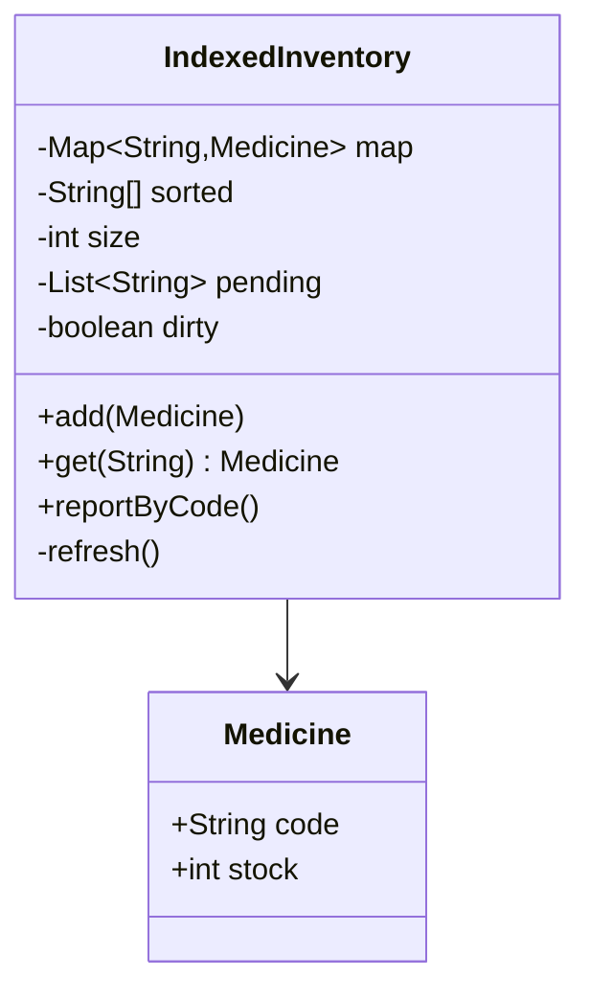

# Q7 – Day-4 Design Challenge: Diagnose, Redesign and Validate

**Name:** RITHISH KUMAR D  |  **Register No.:** 192565089  |  **Course:** Programming in Java (CSA09)  |  **Assignment 2 – CO2**

**Marks:** 13  |  **Bloom's level:** K5 – Evaluate  |  **Files:** `Q7Redesign.java`, `output.txt`

---

## Chosen solution
**Q4 – pharmacy inventory kept in a `HashMap`, with the evening "all medicines in code order" report.** It shows a significant limitation as the *usage pattern* changes: when the code-ordered list is requested repeatedly (several dashboards, reprints, a pharmacist browsing the list while stock is edited) the work of sorting is repeated every time.

---
## A. Diagnose the bottleneck (2 marks)
**Evidence from my own Q4 measurements (HashMap, code-order report, includes the sort):** 1.09 ms (n = 1,000) → 5.52 ms (10,000) → **27.94 ms (100,000)**, against 4.29 ms for the same report from a `TreeMap`. Lookups, in contrast, stay at 13–37 ns, so the lookup is not the problem.

**Evidence from the Q7 program (original solution, n = 100,000, 50 report requests, no changes in between – scenario S3):** 35,586,500 comparisons, 43.1 MB allocated, 1,156.8 ms – i.e. ≈ 712,000 comparisons, ≈ 0.86 MB and ≈ 23 ms *per request* for a result that is **identical every time**.

| Question | Diagnosis |
|---|---|
| Where is most time/memory spent? | In `Collections.sort`/`Arrays.sort` of the key array (≈ all of the comparisons) and in allocating a fresh `String[]` + the sort's merge buffer for every report (43 MB for 50 reports). |
| Which operation grows with the data? | The report: O(n log n) per request, versus O(1) for lookups. It grows from 1 ms to 28 ms for a 100× larger inventory. |
| Is work repeated unnecessarily? | **Yes.** The keys are re-collected and re-sorted from scratch on every request even if nothing has changed (S3) or only 50 of 100,000 medicines are new (S2). |
| Which characteristic of the class causes it? | `HashMap` keeps **no order information**: iteration is in hash order, so the sorted order, once computed, is thrown away and must be recomputed. |

---
## B. Design objective (2 marks)
Derived directly from the diagnosis – the redesign must:
1. **Avoid re-sorting unchanged data:** 0 comparisons when nothing changed; when `k` new medicines were added since the last report, sort **only those `k`** and merge – O(k log k + n) instead of O(n log n). *Target: ≥ 10× fewer comparisons and ≥ 5× less time when `k` ≪ `n` (50 new of 100,000).*
2. **Reduce repeated object creation:** no new key array per report. *Target: ≥ 10× less allocation.*
3. **Preserve correctness:** output identical to the original after every batch, including stock updates (which must not disturb the index).
4. **Do not hurt the hot path:** lookup stays ≤ 50 ns; extra memory ≤ one reference per medicine (≈ 0.4 MB at 100,000).

---
## C. Revised design (4 marks)
**What changed.** The inventory keeps the `HashMap` for lookups and adds a **cached, always-sorted index of codes** that is updated *incrementally*:


```text
add(m):     isNew = (map.put(m.code, m) == null)
            if isNew: pending.add(m.code); dirty = true      // a stock update changes nothing in the index
refresh():  if not dirty: return                            // 0 comparisons
            add = sort(pending)                              // k log k
            ensure capacity(size + k)
            i = size-1; j = k-1; w = size+k-1                // merge from the back, in place
            while j >= 0: sorted[w--] = (i >= 0 and sorted[i] > add[j]) ? sorted[i--] : add[j--]
            size += k; pending.clear(); dirty = false
report():   refresh(); traverse sorted[0..size)             // O(n), the unavoidable output cost
```
**Which property I exploit:** the existing sorted order stays valid when new elements are added; merging two sorted sequences is **linear**, so only the small new batch needs sorting. A dirty flag makes the unchanged case free.

**Operations avoided or reduced:** the full re-sort (O(n log n) → O(k log k + n)); copying all keys into a new array each time; allocation of sort buffers (the merge is in place from the back); and no index work at all for stock updates.

**Memory / preprocessing:** one `String[]` of references (≈ 4 B per medicine, ≈ 0.4 MB at 100,000; the `String` objects are shared with the `HashMap`) with ~50 % growth slack, and one full sort the first time a report is requested.

**New trade-offs:** (i) two structures must be kept consistent (invariant: `sorted ∪ pending` = `map.keySet()`); (ii) a *removal* is not handled by the prototype – it would need an O(n) array delete or tombstones; (iii) the first report still costs a full sort; (iv) if many medicines are added between reports (`k ≈ n`) the benefit shrinks; (v) not thread-safe without locking. Marks are for the reasoning, not for a class name – this is **not** simply "use a `TreeMap`": a `TreeMap` pays O(log n) on *every* put and ~560 ns on *every* lookup to maintain an order that is needed only when a report is printed.

---
## D. Prediction before implementing (1 mark)
From the complexity analysis (not from the measurements):
* **Comparisons.** Original ≈ n·log₂ n per report (≈ 1.7 M for n = 100,000, somewhat less if the hash order contains sorted runs); redesign ≈ n + k·log₂ k (≈ 100 K for k = 50). I predict **≥ 5–10× fewer comparisons** for S1/S2 (k = 50) and **zero** when nothing changed (S3).
* **Time.** Improvement larger than the comparison ratio, because the redesign also avoids the key copy and the merge-buffer allocation: **≈ 10× faster** for S1/S2; for S3 limited only by the O(n) traversal.
* **Weak case.** For a bulk change (S4, k = n/2) the sort of the new batch (k log k) dominates, so I predict only **≈ 2×**.
* **Allocation:** one to two orders of magnitude lower. **Lookup:** unchanged (≈ 30–45 ns).
* **Reference `TreeMap`:** roughly equal for small n; slower than the redesign for report-heavy loads (pointer-chasing traversal) and ~15× slower for lookups.

---
## E. Implement and validate (2 marks)
**Same test conditions** for original, redesign and the `TreeMap` reference: identical random codes, same number of adds and reports, same checksum traversal as the "print"; each figure averaged over 3 runs after a warm-up; first a **correctness check** (original and redesign give identical code-ordered lists after every batch, including stock updates): `true`.

### Source code
```java
import java.lang.management.ManagementFactory;
import java.util.*;

/**
 * Q7 - Diagnose, Redesign, Validate.
 * Chosen solution: Q4 pharmacy inventory kept in a HashMap; the "all medicines in code order" report
 * re-collects and re-sorts every key on EVERY request  (O(n log n) each time, mostly repeated work).
 * Redesign: HashMap (O(1) lookup) + a cached sorted index that is updated incrementally
 *           (sort only the k NEW codes, then merge: O(k log k + n)) and not touched at all when nothing changed.
 */
public class Q7Redesign {
    static long sink = 0;
    static long cmpCount = 0;                                           // comparison counter (operation count)
    static final Comparator<String> COUNTING = (a, b) -> { cmpCount++; return a.compareTo(b); };

    static class Medicine { final String code; int stock; Medicine(String c, int s) { code = c; stock = s; } }

    // ===================== ORIGINAL (Q4 design) =====================
    static class OriginalInventory {
        final Map<String, Medicine> map = new HashMap<>();
        void add(Medicine m) { map.put(m.code, m); }
        Medicine get(String c) { return map.get(c); }
        long reportByCode() {                                           // checksum stands for "print the report"
            String[] keys = map.keySet().toArray(new String[0]);        // hash order = effectively random order
            Arrays.sort(keys, COUNTING);                                // re-sorted from scratch on every request
            long h = 0; for (String k : keys) h = h * 31 + k.hashCode(); return h;
        }
        List<String> orderedCodes() { String[] k = map.keySet().toArray(new String[0]); Arrays.sort(k); return Arrays.asList(k); }
    }

    // ===================== REDESIGN =====================
    static class IndexedInventory {
        final Map<String, Medicine> map = new HashMap<>();              // O(1) lookups preserved
        String[] sorted = new String[16]; int size = 0;                 // cached, always-sorted prefix
        final ArrayList<String> pending = new ArrayList<>();            // codes added since the last report
        boolean dirty = false;

        void add(Medicine m) { if (map.put(m.code, m) == null) { pending.add(m.code); dirty = true; } }   // stock updates leave the index untouched
        Medicine get(String c) { return map.get(c); }

        private void refresh() {
            if (!dirty) return;                                         // nothing changed: zero comparisons
            String[] add = pending.toArray(new String[0]);
            Arrays.sort(add, COUNTING);                                 // k log k
            if (size + add.length > sorted.length) sorted = Arrays.copyOf(sorted, Math.max(sorted.length * 3 / 2, size + add.length));
            int i = size - 1, j = add.length - 1, w = size + add.length - 1;   // in-place merge from the back: O(n + k)
            while (j >= 0) { cmpCount++; if (i >= 0 && sorted[i].compareTo(add[j]) > 0) sorted[w--] = sorted[i--]; else sorted[w--] = add[j--]; }
            size += add.length; pending.clear(); dirty = false;
        }
        long reportByCode() { refresh(); long h = 0; for (int i = 0; i < size; i++) h = h * 31 + sorted[i].hashCode(); return h; }
        List<String> orderedCodes() { refresh(); return new ArrayList<>(Arrays.asList(sorted).subList(0, size)); }
    }

    // ===================== reference: TreeMap =====================
    static class TreeInventory {
        final TreeMap<String, Medicine> map = new TreeMap<>();
        void add(Medicine m) { map.put(m.code, m); }
        Medicine get(String c) { return map.get(c); }
        long reportByCode() { long h = 0; for (String k : map.keySet()) h = h * 31 + k.hashCode(); return h; }
    }

    static long allocated() { return ((com.sun.management.ThreadMXBean) ManagementFactory.getThreadMXBean()).getThreadAllocatedBytes(Thread.currentThread().threadId()); }

    static String code(int v) { return String.format("MED%07d", v); }

    /** verify that original and redesign produce identical ordered output after every batch */
    static boolean verify(int n, int k, int R) {
        Random r = new Random(1); List<Integer> pool = new ArrayList<>(); for (int i = 0; i < n + k * R; i++) pool.add(i * 3 + 1); Collections.shuffle(pool, r);
        OriginalInventory o = new OriginalInventory(); IndexedInventory x = new IndexedInventory(); int p = 0;
        for (int i = 0; i < n; i++) { Medicine m = new Medicine(code(pool.get(p)), 5); p++; o.add(m); x.add(m); }
        if (!o.orderedCodes().equals(x.orderedCodes())) return false;
        for (int rep = 0; rep < R; rep++) {
            for (int i = 0; i < k; i++) { Medicine m = new Medicine(code(pool.get(p)), 5); p++; o.add(m); x.add(m); }
            if (rep % 2 == 0 && n > 0) { Medicine upd = new Medicine(code(pool.get(rep)), 99); o.add(upd); x.add(upd); }   // stock update of an existing code
            if (!o.orderedCodes().equals(x.orderedCodes())) return false;
        }
        return true;
    }

    public static void main(String[] args) {
        System.out.println("Name: RITHISH KUMAR D | Reg.No: 192565089 | Java " + System.getProperty("java.version"));
        System.out.println("\nCorrectness first: original and redesign give identical code-ordered output after every batch (incl. stock updates): "
                + (verify(2000, 25, 40) && verify(5000, 0, 10) && verify(3000, 1500, 3)));

        // name, n (initial medicines), k (new medicines between reports), R (report requests)
        Object[][] scenarios = {
                {"S1  few changes   ", 10_000, 50, 50}, {"S2  few changes   ", 100_000, 50, 50},
                {"S3  no changes     ", 100_000, 0, 50}, {"S4  bulk change    ", 100_000, 50_000, 5}};
        System.out.println("\nEach figure = average of 3 runs after 1 warm-up. ms covers: k adds + 1 report, repeated R times (report = ordered traversal of all codes).");
        System.out.printf("%-20s %8s %6s %4s | %10s %14s %10s | %10s %14s %10s | %10s %10s%n", "Scenario", "n", "k", "R",
                "ORIG ms", "ORIG compares", "ORIG MB", "NEW ms", "NEW compares", "NEW MB", "TreeMap ms", "speed-up");
        for (Object[] sc : scenarios) {
            String name = (String) sc[0]; int n = (Integer) sc[1], k = (Integer) sc[2], R = (Integer) sc[3];
            Random rr = new Random(9); List<Integer> pool = new ArrayList<>(); for (int i = 0; i < n + k * R + 10; i++) pool.add(i * 3 + 1); Collections.shuffle(pool, rr);
            Medicine[] all = new Medicine[pool.size()]; for (int i = 0; i < all.length; i++) all[i] = new Medicine(code(pool.get(i)), 10);
            double[] ms = new double[3]; long[] cmp = new long[2]; double[] mb = new double[2];
            for (int run = -1; run < 3; run++) {
                // ORIGINAL
                OriginalInventory o = new OriginalInventory(); for (int i = 0; i < n; i++) o.add(all[i]);
                cmpCount = 0; long a0 = allocated(); long t0 = System.nanoTime(); int p = n;
                for (int rep = 0; rep < R; rep++) { for (int i = 0; i < k; i++) o.add(all[p++]); sink += o.reportByCode(); }
                long t1 = System.nanoTime(); long a1 = allocated(); long cO = cmpCount;
                // REDESIGN
                IndexedInventory x = new IndexedInventory(); for (int i = 0; i < n; i++) x.add(all[i]); x.reportByCode();   // initial index built once
                cmpCount = 0; long b0 = allocated(); long t2 = System.nanoTime(); p = n;
                for (int rep = 0; rep < R; rep++) { for (int i = 0; i < k; i++) x.add(all[p++]); sink += x.reportByCode(); }
                long t3 = System.nanoTime(); long b1 = allocated(); long cN = cmpCount;
                // TreeMap reference
                TreeInventory tr = new TreeInventory(); for (int i = 0; i < n; i++) tr.add(all[i]);
                long t4 = System.nanoTime(); p = n;
                for (int rep = 0; rep < R; rep++) { for (int i = 0; i < k; i++) tr.add(all[p++]); sink += tr.reportByCode(); }
                long t5 = System.nanoTime();
                if (run >= 0) { ms[0] += (t1 - t0) / 1e6; ms[1] += (t3 - t2) / 1e6; ms[2] += (t5 - t4) / 1e6; mb[0] += (a1 - a0) / 1e6; mb[1] += (b1 - b0) / 1e6; cmp[0] = cO; cmp[1] = cN; }
            }
            System.out.printf("%-20s %8d %6d %4d | %10.1f %14d %10.1f | %10.1f %14d %10.1f | %10.1f %9.1fx%n", name, n, k, R,
                    ms[0] / 3, cmp[0], mb[0] / 3, ms[1] / 3, cmp[1], mb[1] / 3, ms[2] / 3, ms[0] / ms[1]);
        }

        // lookup cost and memory of the structures (the trade-off side)
        int n = 100_000; Random rr = new Random(4); String[] codes = new String[n]; Medicine[] meds = new Medicine[n];
        for (int i = 0; i < n; i++) { codes[i] = code(i * 3 + 1); meds[i] = new Medicine(codes[i], 10); }
        OriginalInventory o = new OriginalInventory(); IndexedInventory x = new IndexedInventory(); TreeInventory tr = new TreeInventory();
        for (Medicine m : meds) { o.add(m); x.add(m); tr.add(m); } x.reportByCode();
        String[] probe = new String[100_000]; for (int i = 0; i < probe.length; i++) probe[i] = codes[rr.nextInt(n)];
        double[] look = new double[3];
        for (int run = -2; run < 5; run++) {
            long t0 = System.nanoTime(); long s = 0; for (String q : probe) s += o.get(q).stock; long t1 = System.nanoTime();
            for (String q : probe) s += x.get(q).stock; long t2 = System.nanoTime();
            for (String q : probe) s += tr.get(q).stock; long t3 = System.nanoTime(); sink += s;
            if (run >= 0) { look[0] += (t1 - t0); look[1] += (t2 - t1); look[2] += (t3 - t2); }
        }
        System.out.printf("%nLookup cost (n=100,000, avg of 5 runs): Original HashMap %.0f ns/get | Redesign (HashMap + index) %.0f ns/get | TreeMap %.0f ns/get%n", look[0] / 5 / probe.length, look[1] / 5 / probe.length, look[2] / 5 / probe.length);
        System.out.printf("Extra retained memory of the redesign's cached index at n=100,000: about %.2f MB (one 4-byte reference per code with compressed oops; the String objects are shared with the HashMap)%n", n * 4 / 1e6);
        System.out.println("(sink=" + (sink != 0) + ")");
    }
}
```

### Output
```text
Name: RITHISH KUMAR D | Reg.No: 192565089 | Java 21.0.12.1

Correctness first: original and redesign give identical code-ordered output after every batch (incl. stock updates): true

Each figure = average of 3 runs after 1 warm-up. ms covers: k adds + 1 report, repeated R times (report = ordered traversal of all codes).
Scenario                    n      k    R |    ORIG ms  ORIG compares    ORIG MB |     NEW ms   NEW compares     NEW MB | TreeMap ms   speed-up
S1  few changes         10000     50   50 |      415.0        4550357        5.2 |       34.4         564100        0.3 |       33.9      12.1x
S2  few changes        100000     50   50 |     1422.4       36360923       43.5 |      103.9        4989128        0.7 |      198.5      13.7x
S3  no changes         100000      0   50 |     1156.8       35586500       43.1 |       15.6              0        0.0 |      185.4      74.2x
S4  bulk change        100000  50000    5 |      406.5       10404664       21.3 |      225.2        4837044       17.1 |      330.2       1.8x

Lookup cost (n=100,000, avg of 5 runs): Original HashMap 40 ns/get | Redesign (HashMap + index) 31 ns/get | TreeMap 563 ns/get
Extra retained memory of the redesign's cached index at n=100,000: about 0.40 MB (one 4-byte reference per code with compressed oops; the String objects are shared with the HashMap)
(sink=true)
```

### Original → Redesigned (n = initial medicines, k = new per report, R = reports)
| Scenario | n | k | R | Original ms | Redesign ms | **Speed-up** | Comparisons original → redesign | Allocated MB original → redesign | TreeMap ms |
|---|---:|---:|---:|---:|---:|---:|---|---|---:|
| S1 few changes | 10,000 | 50 | 50 | 415.0 | 34.4 | **12.1×** | 4,550,357 → 564,100 (8.1× fewer) | 5.2 → 0.3 | 33.9 |
| S2 few changes | 100,000 | 50 | 50 | 1,422.4 | 103.9 | **13.7×** | 36,360,923 → 4,989,128 (7.3× fewer) | 43.5 → 0.7 | 198.5 |
| S3 no changes | 100,000 | 0 | 50 | 1,156.8 | 15.6 | **74.2×** | 35,586,500 → **0** | 43.1 → 0.0 | 185.4 |
| S4 bulk change | 100,000 | 50,000 | 5 | 406.5 | 225.2 | **1.8×** | 10,404,664 → 4,837,044 (2.2× fewer) | 21.3 → 17.1 | 330.2 |

Lookup cost at n = 100,000: original `HashMap` 40 ns/get, redesign 31 ns/get, `TreeMap` 563 ns/get. Extra retained memory of the redesign's index ≈ 0.40 MB.

---
## F. Defend the final design (2 marks)
**Was the prediction supported?** Largely yes. Time improved 12–14× in the few-changes scenarios (predicted ≈ 10×), unchanged data cost **zero** comparisons (74× faster), allocation fell by up to 62× (43.5 → 0.7 MB), and the bulk-change case gave only 1.8× (predicted ≈ 2×). One prediction was **too optimistic**: I expected ≥ 10× fewer comparisons for S1/S2, but observed 7.3–8.1×, because the original `Arrays.sort` (TimSort) already benefits from ordered runs in the hash order of similar codes (≈ 0.71 M comparisons per report instead of the 1.7 M worst case), so the original was better than my formula assumed. The additional time gain beyond the comparison ratio comes from removing the key copy and buffer allocation.

**Magnitude and objective check.** Objective 1 (≥ 5× less time, 0 comparisons when unchanged): met for S1–S3. Objective 2 (≥ 10× less allocation): met (17–62×, S3 zero), except S4 where memory is dominated by the 50,000 new entries. Objective 3 (identical output): verified. Objective 4 (lookup ≤ 50 ns; ≈ 0.4 MB): met (31 ns; 0.40 MB).

**New costs.** Added complexity and an invariant to maintain, unsupported deletion, first-report full sort, no thread-safety, and a small memory increase.

**When the original (or another choice) is still preferable.**
* If the report is really produced **once per evening** (Q4's stated requirement), the original's 28–37 ms (n = 100,000) is ≈ 30× below the 1-second acceptability limit defined in Q4, so the redesign adds complexity for no user-visible gain. The Q4 recommendation (`LinkedHashMap`) stands for that pattern.
* When most of the inventory changes between reports (S4), the gain collapses to 1.8×.
* When simplicity matters and lookups are rare, a plain `TreeMap` is as fast as the redesign for a small inventory (S1: 33.9 vs 34.4 ms) and has no consistency invariant; it is poor only for lookup-heavy loads (563 vs 31 ns).
* When items are frequently *removed*, the prototype would need tombstones or an O(n) delete.

**Final engineering conclusion.** The redesign is justified when the ordered view is read many times between small batches of changes (dashboards, repeated reports): it removes the repeated sorting, cuts allocation by up to 60×, and keeps the 31 ns lookup. For a once-per-evening report the simpler original design is the better engineering decision. The key lesson from the diagnosis is that the cost came from *repeated work caused by a structure that forgets order*, not from `HashMap` being "slow".
